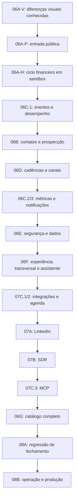

# Fechamento de paridade — revisão de26/10/2026

**Aprovação:** o usuário aprovou expressamente esta atualização dos marcos em26/10/2026. Próximo pacote: fechamento das diferenças conhecidas de06A-V e execução de06A-P; depois06A-H. A aprovação do roteiro não constitui aceite de implementação dos módulos pendentes.

## Objetivo e critério atualizado

Reproduzir a experiência visual, os fluxos e as funcionalidades de produto do CadenceFlow no Prometeus, preservando as decisões explícitas do usuário. O operador esclareceu que não exige comprovar uma implementação interna idêntica ao backend da referência. Essa condição substitui o entendimento de que a falta de acesso ao backend original impediria concluir qualquer funcionalidade.

O backend próprio precisa funcionar: persistência, isolamento, permissões, filas, quotas, integrações, resultados e recuperação devem ser testados no Prometeus. Quando a regra da referência não puder ser observada, registrar o contrato adotado e sua origem; validá-lo localmente sem chamá-lo de reprodução verificada daquela regra.

As decisões preservadas são trial de7 dias sem cobrança automática, consumo adicional pré-pago, OpenWA gerenciado, modelos conectados por workspace e infraestrutura própria. Marca e assets reimplementados continuam classificados separadamente da comparação de geometria e comportamento. Recursos pendentes só se tornam contratáveis depois do seu aceite operacional.

## Base da revisão

- Auditoria funcional de24/10: [matriz](../../reverse-engineering/reaudit-2026-10-24/clone/parity.md) e [achados](../../reverse-engineering/reaudit-2026-10-24/findings.md), com baseline datado, sem presumir que todos os achados antigos continuam iguais.
- Auditoria visual de25–26/10: [relatório](../../reverse-engineering/visual-2026-10-25/REPORT.md),50 rotas em dois viewports,28 overlays e testes específicos. Essas contagens não são percentuais de paridade.
- Rechecagem de26/10: [inventário pareado de11 telas](../../reverse-engineering/visual-2026-10-25/evidence/EV-266-roadmap-review.json), na referência autenticada e no localhost, somente leitura, incluindo segurança, privacidade, duplicados, MCP, apps, prospecção, LinkedIn e SDR. Foram lidas as implementações locais correspondentes. Botão desabilitado por formulário vazio não foi usado, sozinho, como prova de funcionalidade ausente. Ausência de heading em canvas não foi tratada como tela vazia.
- REA: cenários finitos de login público da referência e local,1280×800, espera por campo de e-mail visível, sem submissão; ambos concluídos e processos próprios encerrados. Identificadores e limitações estão na evidência acima. Isso não comprova sessão autenticada, compra, entrega de mensagem nem backend da referência.
- Assinatura inicial Essential já homologada em sandbox: [validação06A](../../validation/06-billing.md). Os demais fluxos financeiros continuam com aceite próprio pendente.

RES organiza a separação entre observação, hipótese, implementação e validação. Nenhuma nova ferramenta, conta ou integração foi instalada/conectada nesta revisão.

## Recomendação

Manter01–05 e os aceites existentes como histórico. Ajustar06B–06E/07A–07C para entregas menores, com fechamento visual e funcional por área. Adicionar quatro marcos explícitos para lacunas que hoje ficam distribuídas ou sem dono:

| Novo marco | Motivo | Resultado de aceite |
|---|---|---|
| **06A-P — Entrada pública e ativação da conta** | Cadastro ainda difere em telefone/documentos; callbacks, convites e estados de token precisam da mesma cobertura das telas internas | Cadastro→verificação→workspace→plano/trial; recuperar senha; convite e token inválido/expirado; telefone com persistência/destino definido; documentos próprios publicados e consentimento versionado quando aplicável; UI desktop/mobile e falhas |
| **06A-H — Homologação do ciclo financeiro existente** | O pagamento inicial passou; não encerra pacotes, alteração, renovação ou cancelamento | Stripe sandbox: créditos concedidos uma vez, troca de pagamento, upgrade/downgrade, renovação/falha, cancelamento e reativação suportada; eventos fora de ordem/repetidos; UI acompanha estado autoritativo |
| **06F — Experiência transversal e assistente** | Assistente local ainda é modal de atalhos; referência tem painel conversacional com contexto. Busca, onboarding e ajudas exigem fluxos próprios | Painel com geometria/responsividade correspondente; perguntas sobre a conta com dados autorizados, diagnóstico e links úteis; propostas de ações revisadas antes de confirmar; busca no escopo observado; checklist/tours e ajudas com destinos reais |
| **06G — Catálogo comercial completo e capacidade adicional** | Anual/cupom e extras de capacidade não estão implementados; créditos de consumo e capacidade são unidades diferentes | Catálogo-alvo versionado; ciclo anual/cupom conforme regra definida; caixas/números/assentos adicionais com vigência e quotas; módulos só vendidos após entrega; consumo continua pré-pago; testes de compra, expiração, redução e conciliação |

06A-H fecha o que já existe.06G amplia o catálogo depois que os recursos correspondentes estiverem operacionais. Nenhum deles autoriza cobrança live nesta etapa.

## Ajustes nos marcos existentes

### 06A-V — Fechamento visual contínuo

O escopo deixa de ser apenas plano/cobrança. Tratar como porta de qualidade de todas as áreas: inventário versionado de rotas, subrotas, abas, menus, popups e estados; comparação pareada antes/depois, no mesmo viewport e situação de dados. Corrigir diferenças conhecidas de áreas já disponíveis e associar cada superfície pendente ao marco que entrega sua operação.

Exemplo concreto ainda aberto: assistente lateral conversacional da referência versus modal central de atalhos local. Abrir/cancelar um popup sem erro não aceita sua geometria, conteúdo nem comportamento. Ilustrações, ícones e estados expandidos também precisam de classificação, sem aceite automático por compartilhar CSS.

### 06B — Contatos, fontes, qualificação e autoria de automações

Dividir a execução em dois pacotes:

1. **06B.1 — Base e busca:** filtros/colunas/listas/ações, importação e mapeamento completos, fontes e filtros realmente suportados, sugestão de público/nicho com IA, destino, deduplicação e execução revisada. Fechar rascunho→revisão→job→resultado→contato; nenhuma lista criada só por pedir uma proposta.
2. **06B.2 — Qualificação/enriquecimento/recorrência:** módulos individuais, dados de decisores, resultado útil/cache/consumo único, classificação com evidência, qualidade de contato corretamente identificada; configuração, agenda, reengajamento e recuperação das automações. Verificação inconclusiva não vira e-mail válido ou WhatsApp confirmado.

Reaproveitar03/03B/04: não reconstruir jobs, roteamento de IA, reservas ou scheduler que já funcionam. Inspecionar e completar os contratos e as telas que faltam.

### 06C — Dados de operação, velocidade e comunicação

Dividir em três pacotes com dependências explícitas:

1. **06C.1 — Eventos e desempenho:** definições de métricas, eventos persistentes, agregações por workspace/período/fuso, consultas paginadas, rastreamento do estado de jobs/canais e atualização contínua limitada. Medir navegação e APIs antes de fixar e cumprir um orçamento de latência; testar concorrência, pausa/retorno, rede indisponível e preservação de rascunhos. Contagens do modo autenticado não podem vir de simulações legadas.
2. **06C.2 — Dashboard/relatórios/execuções:** projeções reconciliadas com os eventos, detalhe de execução, filtros, séries, funil, relatórios por cadência/etapa/horário quando medidos e drill-down. Distinguir zero de indisponível. Depende dos eventos de06D e dos jobs de06B.
3. **06C.3 — Notificações e resumos:** contador de não lidos, som, feed, agrupamento, preferências por evento/canal, janela de silêncio, telefone de avisos e relatórios agendados; entrega limitada e idempotente. Relatórios/perfis salvos não bastam sem o serviço de envio correspondente.

A referência pode chamar uma métrica de “leitura”; o contrato local deve registrar exatamente o que foi observado pelo provedor. Abertura de pixel não prova leitura humana.

### 06D — Autoria e operação de mensagens

1. **06D.1 — Editor e publicação:** quatro modos de criação observados, modelos de sistema/reutilizáveis, variáveis/prévia/IA, ordenação, rascunhos, versões de mensagem, anexos conforme canal, agenda/janelas e revisão antes de publicar. Cada controle precisa estar ligado a uma operação real; nenhuma versão B ou anexo pode existir só na apresentação.
2. **06D.2 — Canais/inbox/piloto:** conectar/gerenciar/revogar/recuperar; threads e respostas nos canais correspondentes; vínculo entre enviado e recebido; filtros, opt-out, parada após resposta e limites compartilhados; anexos/recibos quando suportados. Testar falha, reinício, resultado incerto e ausência de duplicação. Definir e implementar eventos de entrega/abertura/clique suportados, consumidos por06C.2; não prometer telemetria que o canal não fornece.

Reaproveitar Gmail/SMTP/IMAP/Meta/OpenWA e os testes existentes. A homologação de ida e volta usa somente contas e destinatários próprios autorizados; QR/readiness não fecha o aceite de entrega.

### 06E — Segurança e ciclo dos dados

Separar **06E.1** (papéis, convites/assentos, autenticação forte, dispositivos e sessões, revogação) de **06E.2** (duplicados e fusões reais, retenção, exclusão/exportação e trilha de auditoria). A procura local por e-mail nos contatos carregados ainda não é motor completo de mesclagem. Uma preferência de retenção desabilitada não é executor de expurgo.

Definir o resultado de desfazer uma fusão antes de oferecer recuperação na UI. Conteúdo removido precisa deixar de aparecer nas telas, pesquisas e contexto de IA; manter apenas metadados autorizados do evento.

### 07A — LinkedIn

Separar **07A.1** (viabilidade/conexão, público por filtros/post, campanha de convites, ritmo, fila e aceites) de **07A.2** (pessoas/pipeline, destino dos aceites, enriquecimento, cadência posterior, templates e aprovações). Começar por uma prova técnica do adaptador próprio; apresentação de campanha ou estimativa ilustrativa não demonstra busca/convite operacional.

### 07C — Integrações antes do fechamento do SDR

Executar os contratos que o SDR precisa antes de seu piloto:

- **07C.1:** APIs e eventos de domínio, outbox, assinatura/segredo por destino, retries, histórico, revogação e contratos de agenda/CRM necessários às ações do agente.
- **07C.2:** conexão e sincronização por workspace de CRM, Sheets, Apollo e agenda que façam parte do escopo; mapeamento, origem/destino, desconexão e retorno de erro. MeetFlow é superfície de integração/produto externo observada, não autorização para reconstruir um SaaS inteiro de reuniões; reproduzir os destinos/fluxos que o CadenceFlow oferece. Funcionalidade interna não observada permanece distinguida.
- **07C.3:** servidor MCP do Prometeus com autenticação, escopos e ferramentas reais, reaproveitando os mesmos comandos revisados/permissões da aplicação e do assistente. OAuth de modelos em03B é outro contrato e já existe; não confundi-lo com esse conector.

### 07B — SDR

Separar **07B.1** (configuração, roteiro, canais, contexto, qualificação e propostas/aprovações) de **07B.2** (conversa real, memória por thread, limites, agenda/CRM, follow-up, parada/opt-out e handoff humano). O piloto07B.2 depende das operações reais de06D e07C.1/07C.2. O desenho público de um agente não prova as regras internas da referência: completar os contratos próprios e identificá-los como tais.

### 07D,08A e08B

07D continua descoberta condicional de scoring/Hot Now: não acrescentar uma implementação obrigatória só por documentação antiga. Se a oferta atual não confirmar o recurso, registrar a decisão de escopo.

08A passa a consolidar a regressão das áreas já aceitas. Não recebe a dívida visual inteira. Cobrir desktop/tablet/mobile, texto/tema, teclado/foco, vazio/populado/loading/falha/limite/bloqueio e jornadas atravessando módulos. Estados da referência não observados continuam assim rotulados; regras próprias podem ter teste completo sem se tornarem evidência do backend concorrente.

08B mantém operação/produção: estabilidade prolongada, recuperação de provedores, backup/restauração, isolamento, atualização do banco, implantação/rollback, orçamento de desempenho, inicialização e encerramento dos serviços sem terminais visíveis. Preparar produção sem habilitar cobrança live nem envios externos automaticamente.

## Sequência recomendada

Essa é uma ordem de integração, não uma proibição de trabalho independente.06C.1 e os contratos de07C.1 podem ser preparados antes dos seus consumidores. Segurança básica/isolamento existentes continuam obrigatórios em todos os marcos; não são adiados para06E. O aceite de cada recurso antecede sua oferta comercial.

## Como um marco passa a estar concluído

Para cada item do inventário, manter uma linha com rota/estado, origem da regra, contrato esperado, implementação local, evidência visual, prova funcional e divergência. Classificações:

| Eixo | Estados de aceite |
|---|---|
| Referência | observado; documentado; inferido; não observado |
| Implementação própria | ausente; apresentação; parcial; operacional testada |
| Visual | não comparado; diferenças abertas; comparado no estado/viewport declarado |
| Funcionamento | caso feliz; falha/recuperação; permissão/isolamento; efeito externo próprio homologado quando aplicável |
| Exceção | divergência aprovada pelo usuário; contrato próprio identificado; dependência externa ainda pendente |

O alvo “100%” só tem denominador útil com um inventário-alvo versionado. Não significa o backend privado idêntico, nem todas as páginas imagináveis. Significa que cada item contratado foi entregue e testado, que diferenças conhecidas têm dono e que limites de observação não foram apagados para produzir uma porcentagem.

**Atualização de execução26/10:** o pacote06A-P e a forma do assistente06A-V foram implementados e verificados no escopo de [06-entry](../../validation/06-entry.md), incluindo documentos próprios de homologação preparados a pedido do operador. A descrição anterior da revisão continua sendo histórico; não é aceite dos demais módulos.

**Atualização financeira26/10:**06A-H concluído no escopo de [homologação financeira](../../validation/06-billing-homologation.md): efeitos externos próprios em sandbox, regressões, UI desktop/mobile e limpeza QA. A assinatura original foi preservada; nenhum efeito live.

**Próxima entrega concreta:**06C.1 — eventos e desempenho, medindo navegação/APIs e fechando atualização contínua e preservação de rascunhos antes dos consumidores de métricas. Conversa/diagnósticos reais do assistente permanecem06F; estados não observados da referência continuam identificados e não são convertidos em aceite100%.
